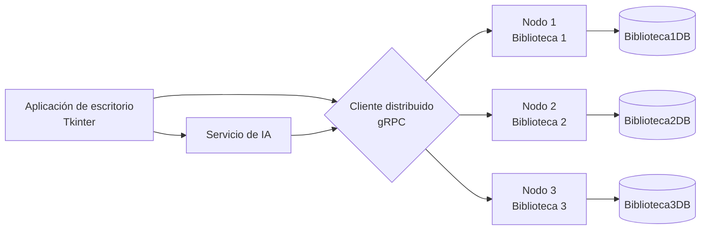

<div align="center">

# Sistema Distribuido de Consulta Inteligente de Libros

**Gestión bibliotecaria distribuida en tres nodos con consultas en lenguaje natural mediante IA**


*Universidad Manuela Beltrán · Ingeniería de Software · 7° Semestre*

</div>

---

## Descripción

Aplicación de escritorio desarrollada en **Python** para gestionar libros, usuarios, préstamos y devoluciones en **tres bibliotecas independientes**. Cada biblioteca funciona como un nodo autónomo con su propia base de datos **SQL Server**, y los nodos se comunican mediante **gRPC/RPC**. Incluye un **módulo de Inteligencia Artificial** que permite consultar la disponibilidad de libros usando lenguaje natural, respondiendo solo con datos reales obtenidos de las bases de datos.

## Problema

Buscar libros en varias bibliotecas puede ser lento e ineficiente, y no existe una forma sencilla de consultar la disponibilidad en tiempo real. Esto dificulta la experiencia de los usuarios y hace compleja la gestión manual de las bibliotecas.

## Funcionalidades

| Módulo | Descripción |
|--------|-------------|
| **Gestión bibliotecaria** | CRUD de libros, usuarios, préstamos y devoluciones |
| **Consultas con IA** | Preguntas en lenguaje natural sobre las tres bibliotecas |
| **Consulta distribuida** | Intercambio de información entre nodos en tiempo real |
| **Disponibilidad y reportes** | Control de inventario y generación de reportes |
| **Transacciones** | Préstamos y devoluciones con garantías ACID |

---

## Arquitectura

### Distribución física



- **Nodos independientes:** cada biblioteca gestiona su propio inventario, usuarios, préstamos y disponibilidad.
- **Comunicación:** gRPC/RPC, con un contrato tipado común a los tres nodos.
- **Persistencia:** una base de datos SQL Server por nodo.

### Organización por capas

El código está organizado en cuatro capas, con dependencia en un solo sentido:

```
    Presentación  ──────►  Negocio  ──────►  Datos
          │                   │                │
          └───────────────────┴────────────────┘
                              ▼
                          Entidades
```

| Capa | Carpeta | Responsabilidad |
|---|---|---|
| **Entidad** | `entidades/` | Clases del dominio: libro, ejemplar, usuario, préstamo. Sin lógica. |
| **Datos** | `datos/` | Única capa que habla con SQL Server: conexiones, transacciones y consultas. |
| **Negocio** | `negocio/` | Las reglas: cupos, vencidos, ejecución atómica del préstamo. Sin SQL. |
| **Presentación** | `presentacion/` | Interfaz Tkinter (`escritorio/`) y fachada gRPC del nodo (`servicios/`). |

La configuración (`configuracion/`) es transversal. El detalle del diseño está en [`docs/Arquitectura_por_capas.md`](docs/Arquitectura_por_capas.md).

### Cómo se mantiene la coherencia entre bibliotecas

**No hay replicación de datos entre nodos, y es una decisión deliberada.** Cada biblioteca es dueña exclusiva de su inventario: nadie escribe en la base de otra sede. La vista unificada se construye **en el momento de la consulta**, preguntando a los tres nodos en paralelo y agregando lo que cada uno responde.

Esto tiene tres consecuencias que conviene tener presentes:

- **No existen conflictos de escritura.** Al no haber copias del mismo dato en dos lugares, no hay nada que reconciliar.
- **Lo que se ve está siempre al día.** No hay ventana de sincronización: un préstamo registrado en la sede 2 aparece en la consulta global en la siguiente llamada. Esto se comprueba en el caso **PT-02**.
- **Si una sede no responde, las demás siguen operando.** El sistema informa cuál falló en lugar de caerse. Se comprueba en **PT-07**.

---

## Operaciones CRUD y propiedades ACID

| CRUD | | ACID | Cómo se garantiza | Caso que lo prueba |
|------|---|------|---|---|
| **Create** | Registrar libros, usuarios y préstamos | **Atomicidad** | Una sola transacción por operación; `rollback` ante cualquier error | PT-06 |
| **Read** | Consultar libros, usuarios y disponibilidad | **Consistencia** | `CHECK` y llaves foráneas en el esquema | PT-05 |
| **Update** | Modificar información y disponibilidad | **Aislamiento** | `UPDLOCK, ROWLOCK, READPAST` al tomar el ejemplar | PT-08 |
| **Delete** | Eliminar o desactivar registros | **Durabilidad** | `commit` de SQL Server | PT-03, PT-04 |

---

## Pruebas transaccionales

El proyecto incluye una suite que ejecuta casos verificables contra los nodos reales. Cada caso **compara el estado de la base antes y después de la operación**, de modo que el resultado no depende de lo que informe la aplicación sino de lo que quedó efectivamente guardado.

```bash
# Con los nodos levantados y los datos de ejemplo cargados
python herramientas/pruebas_transaccionales.py --nodo 1
```

La suite deja un reporte fechado en `docs/evidencias/` con el detalle de cada comprobación: qué se esperaba, qué se obtuvo y si coincidieron.

### Casos

| Caso | Qué verifica | Comprobaciones | Criterio de aceptación |
|---|---|---|---|
| **PT-01** | Consulta de disponibilidad distribuida | 5 | La consulta llega a las tres sedes, cada fila viene identificada por biblioteca y los disponibles nunca superan el total |
| **PT-02** | Sincronización entre bibliotecas | 3 | Un préstamo en una sede se refleja en la consulta agregada en la llamada siguiente, sin reiniciar ni sincronizar a mano |
| **PT-03** | Registro de préstamo | 5 | El préstamo queda `ACTIVO`, el inventario baja exactamente en uno y aparece entre los activos del usuario |
| **PT-04** | Registro de devolución | 3 | El inventario vuelve a su valor original y el préstamo queda `DEVUELTO` |
| **PT-05** | Reglas de negocio y errores | 5 | Devolver dos veces → `FAILED_PRECONDITION`; libro o usuario inexistente → `NOT_FOUND`; título agotado → `RESOURCE_EXHAUSTED`; el nodo sigue en pie |
| **PT-06** | Atomicidad | 3 | Una operación rechazada no deja rastro: ni préstamo registrado ni ejemplar descontado |
| **PT-07** | Tolerancia a un nodo caído | 5 | Con una sede inalcanzable, la consulta devuelve los datos de las demás e informa cuál falló, sin lanzar excepciones |
| **PT-08** | Concurrencia sobre el mismo título | 7 | Ante *N+1* solicitudes simultáneas de un título con *N* ejemplares, se aceptan exactamente *N* y se rechaza una; ningún ejemplar se entrega dos veces |

### Sobre el caso de concurrencia

PT-08 es el que demuestra el aislamiento. Lanza varios hilos sincronizados con una barrera, de modo que todas las solicitudes lleguen al nodo al mismo tiempo, y comprueba que el sistema no entregue más ejemplares de los que existen.

La prueba se validó contra una implementación deliberadamente defectuosa, sin bloqueo en la sección crítica, para confirmar que detecta el problema y no pasa por inercia. En ese escenario falla como debe:

```
[PT-08] Concurrencia sobre el mismo titulo
     OK    Todas las solicitudes obtuvieron respuesta
    FALLA  Se entregaron exactamente los ejemplares que existian
           esperado: 1
           obtenido: 2
    FALLA  Ningun ejemplar se entrego dos veces
           esperado: 2
           obtenido: 1
          2 solicitudes simultaneas con 1 ejemplar: 2 aceptadas, 0 rechazadas.
          Ejemplares entregados: [6, 6]
```

El mismo ejemplar entregado a dos usuarios es exactamente lo que `UPDLOCK, ROWLOCK, READPAST` evita en la implementación real.

### Otras comprobaciones

```bash
python herramientas/diagnostico.py              # driver ODBC y conexión a las 3 bases
python herramientas/probar_nodos.py             # ping en paralelo a los 3 nodos
python herramientas/probar_nodos.py --titulo "cien"   # disponibilidad agregada
python herramientas/probar_flujo.py --nodo 1    # ciclo préstamo-devolución end to end
```

---

## Tecnologías

- **Lenguaje:** Python 3.10+
- **Interfaz gráfica:** Tkinter
- **Comunicación:** gRPC con Protocol Buffers
- **Base de datos:** Microsoft SQL Server (pyodbc)
- **IA:** módulo de procesamiento de lenguaje natural *(documentado, pendiente de implementar)*
- **IDE:** Visual Studio Code / PyCharm

## Base de datos

El script `SQLQuery_BibliotecasDB.sql` contiene la estructura de un nodo. Hay que ejecutarlo tres veces, cambiando el nombre de la base en `CREATE DATABASE` y `USE`:

```sql
Biblioteca1DB     Biblioteca2DB     Biblioteca3DB
```

Cada base mantiene su propia tabla `Usuario`, así que los códigos de usuario se repiten entre sedes y **no corresponden a la misma persona**. Un préstamo solo puede registrarse a un lector inscrito en esa biblioteca.

Para trabajar con los datos compartidos entre varios equipos, ver [`docs/Base_de_datos_compartida.md`](docs/Base_de_datos_compartida.md).

## Usuarios del sistema

- **Administradores:** configuración y control general del sistema.
- **Bibliotecarios:** gestión de inventario, préstamos y devoluciones.
- **Usuarios:** estudiantes y público en general que consultan libros.

---

## Instalación

```bash
git clone https://github.com/pipeeex/intelligent-library-search-system.git
cd intelligent-library-search-system

python -m venv venv
venv\Scripts\activate          # Windows
source venv/bin/activate       # Linux o macOS

pip install -r requirements.txt

copy .env.example .env         # y ajustar DB_SERVER y el driver ODBC
python herramientas/generar_protos.py
```

Hace falta el **ODBC Driver 17 o 18 for SQL Server**. Si algo falla en la conexión, `python herramientas/diagnostico.py` prueba las combinaciones posibles y dice qué poner en el `.env`.

## Ejecución

```bash
# 1. Un nodo por terminal
python servidor.py --nodo 1
python servidor.py --nodo 2
python servidor.py --nodo 3

# 2. Datos de ejemplo (la primera vez)
python herramientas/cargar_datos.py --todos

# 3. La interfaz
python aplicacion.py
python aplicacion.py --demo    # datos de prueba, sin backend
```

La aplicación detecta sola si los nodos responden. Si ninguno contesta, cae a datos de prueba en memoria y lo indica en la barra inferior.

---

## Estado del proyecto

| Componente | Estado |
|---|---|
| Esquema de base de datos de los tres nodos | Terminado |
| Capa de datos con transacciones ACID | Terminado |
| Reglas de préstamo y devolución | Terminado |
| Contrato gRPC (19 operaciones) | Terminado |
| Servidor de nodo y cliente distribuido | Terminado |
| Interfaz de escritorio | Terminado |
| Suite de pruebas transaccionales | Terminado |
| Intérprete del módulo de IA | Pendiente |
| Autenticación y roles | Pendiente |
| Reportes de inventario y mora | Pendiente |

El plan para lo pendiente está en el documento maestro, apartado *Plan de continuidad*.

## Resultado esperado

Un sistema funcional, distribuido y seguro que permita gestionar tres bibliotecas y realizar consultas inteligentes de libros en lenguaje natural.

## Información académica

| Universidad | Programa | Nivel | Modalidad |
|-------------|----------|-------|-----------|
| Universidad Manuela Beltrán | Ingeniería de Software | 7° Semestre | Presencial |

## Autores

- [@Felipe Villaquiran](https://github.com/pipeeex)
- [@Alejandro Mier](https://github.com/Cachureto)
- [@Gabriel Badillo](https://github.com/gabrielbadillo123)

---

<div align="center">
<sub>Desarrollado con 💙 en Python · Grupo 6</sub>
</div>
